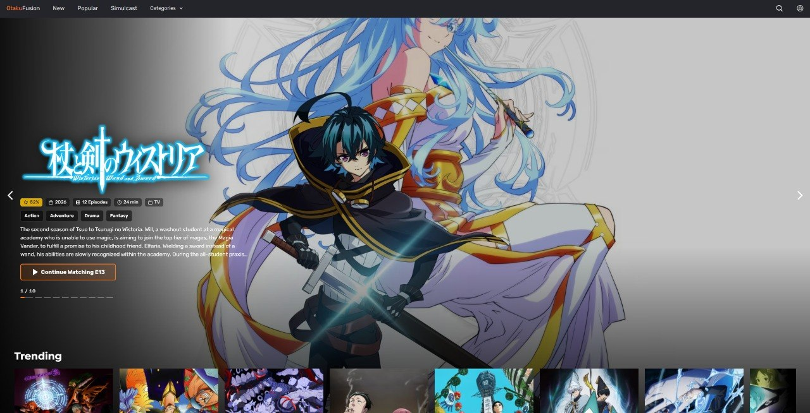
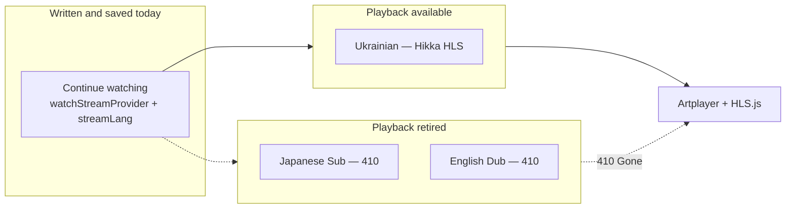
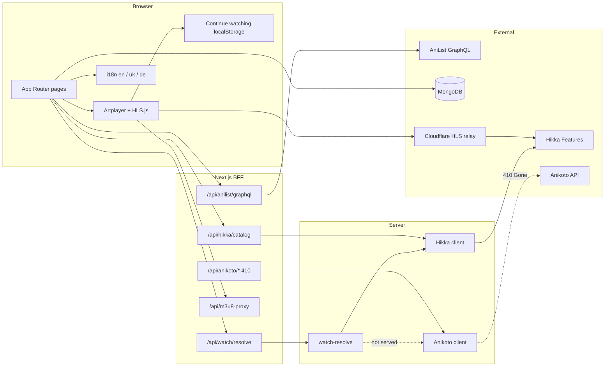

<div align="center">

# OtakuFusion

**A modern anime streaming web app** — discovery, a custom HLS player, accounts, and multi-language UI.

[](https://nextjs.org/)
[](https://react.dev/)
[](https://www.typescriptlang.org/)
[](LICENSE)
[](https://github.com/Pashahu1/OtakuFusion/actions/workflows/ci.yml)
[](https://otaku-fusion.vercel.app/)

[Live demo](https://otaku-fusion.vercel.app/) · [Features](#features) · [Playback](#playback) · [Quick start](#quick-start) · [Deploy](#deployment-vercel)

</div>



---

## Overview

OtakuFusion is a full-stack **Next.js 16** (App Router) app for browsing and watching anime.

- **Metadata** comes from **AniList**.
- **Live playback today** is **Ukrainian** via **Hikka** (server-side resolve → HLS).
- The player is **Artplayer + HLS.js**, with skip intro/outro, quality, enhance, and continue watching.
- UI language is **English / Українська / Deutsch** (client i18n). Catalog titles, genres, and episode names stay **English** (API data).

**Live demo:** [https://otaku-fusion.vercel.app/](https://otaku-fusion.vercel.app/)

This is a **portfolio / educational project**, not a licensed commercial streaming service.

---

## Playback

| Track | Provider | Status |
|-------|----------|--------|
| **Ukrainian** | Hikka | **Available** — default live stream |
| **Japanese (Sub)** | — | **Retired** — `/api/anikoto/*` returns **410 Gone** |
| **English (Dub)** | — | **Retired** — `/api/anikoto/*` returns **410 Gone** |

Japanese / English are not served. The leftover UI flag stays off; do not point the app at an Anikoto scraper. Continue watching may still store an old `watchStreamProvider` value — it remaps to Hikka.

Default provider for new sessions is **Hikka (UA)**.



---

## Table of contents

- [Features](#features)
- [Screenshots](#screenshots)
- [Playback](#playback)
- [Tech stack](#tech-stack)
- [Architecture](#architecture)
- [Known limitations](#known-limitations)
- [Prerequisites](#prerequisites)
- [Quick start](#quick-start)
- [Environment variables](#environment-variables)
- [Scripts](#scripts)
- [Project structure](#project-structure)
- [Deployment (Vercel)](#deployment-vercel)
- [Contributing](#contributing)
- [Author](#author)

---

## Screenshots

The banner above is the **home page** (spotlight + trending).

For **watch**, **HLS playback**, and **account** flows, open the [live demo](https://otaku-fusion.vercel.app/).

---

## Features

### Watch

- Custom **Artplayer** UI — HLS quality ladder, skip intro/outro, next episode, optional Anime4K enhance
- **Continue watching** — progress, resume position, and stream prefs (saved Anikoto values remap to Hikka)
- Server-side **stream resolve** (`/api/watch/resolve`) with retries
- Optional **Cloudflare HLS relay** for CDN segments that need Referer / CORS

### Discover

- Home spotlight carousel and catalog rows
- Search with debounce
- Genre hub + discover sections (new / popular / simulcast)
- Release schedule calendar

### Account

- Register / login with email verification (SMTP)
- Profile, heatmap, activity, optional Cloudinary avatar
- Favorites synced to MongoDB
- Appearance: five dark themes + UI language (en / uk / de)

---

## Tech stack

| Area | Technologies |
|------|----------------|
| App | Next.js 16 (App Router, Turbopack), React 19, TypeScript |
| Styling | Tailwind CSS 4, SCSS design tokens (`data-theme`) |
| Video | Artplayer 5, HLS.js, `/api/m3u8-proxy`, optional Cloudflare relay |
| Data (UI) | TanStack Query |
| Data (watch) | Feature hooks + `localStorage` (continue watching, provider map) |
| i18n | i18next + react-i18next (`en`, `uk`, `de`) |
| API | Next.js Route Handlers, Zod |
| Auth | JWT (`jose` HS256) + HTTP-only cookies |
| Database | MongoDB (Mongoose) |
| Metadata | AniList GraphQL |
| Streams | Hikka (live UA); `/api/anikoto/*` is 410 Gone |
| Tests | Vitest |

---

## Architecture



**Live resolve (Hikka / UA):**

1. Client loads the Ukrainian catalog via `POST /api/hikka/catalog`.
2. `GET /api/watch/resolve?provider=hikka` extracts a playable HLS URL.
3. Artplayer plays the stream (direct, `/api/m3u8-proxy`, or `NEXT_PUBLIC_M3U8_PROXY_BASE`).

**Anikoto (JP sub · EN dub):** `/api/anikoto/*` is **410 Gone**. Playback stays on Hikka only.

---

## Known limitations

| Area | What to expect |
|------|----------------|
| **Japanese / English** | Not offered. `/api/anikoto/*` is **410 Gone**. |
| **Third-party streams** | UA playback depends on Hikka. Coverage and uptime are not under our control. |
| **Hikka on Vercel** | Upstream may block the server IP — set **`HIKKA_FEATURES_RELAY_BASE`** if Ukrainian tracks return 403. |
| **HLS on Vercel** | Some CDNs need **`NEXT_PUBLIC_M3U8_PROXY_BASE`** (`workers/hls-relay`). Same-origin `/api/m3u8-proxy` is fine locally. |
| **Catalog copy** | Series titles, genres, and episode names stay English (API). Only chrome/UI is translated. |
| **Account** | Register/login and favorites work; email verification is optional. |
| **Scope** | No native app, offline/PWA, or guaranteed audio track for every episode. Continue watching is browser `localStorage`; favorites are MongoDB for signed-in users. |

---

## Prerequisites

| Requirement | Required? | Notes |
|-------------|-----------|--------|
| Node.js 22 | Yes | Matches CI |
| MongoDB | Yes | Auth, favorites |
| SMTP | Yes | Verification emails |
| Hikka | Yes for UA playback | Direct or `HIKKA_FEATURES_RELAY_BASE` |
| `NEXT_PUBLIC_SITE_URL` | Recommended | Metadata |
| Cloudinary | Optional | Avatars |
| TVDB API key | Optional | Hero clear logos |
| Cloudflare HLS relay | Optional | `workers/hls-relay` |

---

## Quick start

### 1. Clone & install

```bash
git clone https://github.com/Pashahu1/OtakuFusion.git
cd OtakuFusion
npm install
```

### 2. Configure environment

```bash
cp .env.example .env.local
```

**Minimum `.env.local`:**

```env
MONGODB_URI=mongodb+srv://...
NEXT_JWT_ACCESS_SECRET=   # openssl rand -base64 32
NEXT_JWT_REFRESH_SECRET=  # different random string
SMTP_HOST=
SMTP_PORT=587
SMTP_USER=
SMTP_PASS=

NEXT_PUBLIC_SITE_URL=http://localhost:3000
WATCH_PROBE_SKIP_VARIANT=1

# Optional — if Hikka blocks your IP
# HIKKA_FEATURES_RELAY_BASE=https://your-hikka-relay.workers.dev
```

Full reference: **[`.env.example`](.env.example)**.

### 3. Run locally

```bash
npm run dev
```

Open **[http://localhost:3000](http://localhost:3000)**.

### 4. Production checks

```bash
npm run lint
npm run type-check
npm run test
npm run build
```

Or one shot:

```bash
npm run predeploy
```

### 5. Optional: HLS relay

```bash
cd workers/hls-relay
npx wrangler deploy
```

Set `NEXT_PUBLIC_M3U8_PROXY_BASE` to the worker URL, then restart / redeploy the app.

---

## Environment variables

### Required

| Variable | Purpose |
|----------|---------|
| `MONGODB_URI` | Database |
| `NEXT_JWT_ACCESS_SECRET` / `NEXT_JWT_REFRESH_SECRET` | Auth tokens |
| `SMTP_*` | Email |

### Recommended on Vercel

| Variable | Purpose |
|----------|---------|
| `NEXT_PUBLIC_SITE_URL` | Canonical production URL |
| `WATCH_PROBE_SKIP_VARIANT=1` | Faster watch resolve |
| `HIKKA_FEATURES_RELAY_BASE` | Hikka relay if origin IP is blocked |
| `NEXT_PUBLIC_M3U8_PROXY_BASE` | Cloudflare HLS relay |

### Optional

| Variable | Purpose |
|----------|---------|
| `TVDB_API_KEY` | Hero artwork |
| `CLOUDINARY_*` | Avatar upload |
| `NEXT_PUBLIC_HLS_DIRECT_HOST_SUFFIXES` | CDN hosts that skip `/api/m3u8-proxy` |

Never commit `.env` or secrets. Use **`.env.local`** for development.

---

## Scripts

| Command | Description |
|---------|-------------|
| `npm run dev` | Next.js dev server (Turbopack) |
| `npm run build` | Production build |
| `npm run start` | Serve production build |
| `npm run lint` | ESLint |
| `npm run type-check` | `tsc --noEmit` |
| `npm run test` | Vitest |
| `npm run predeploy` | lint → tsc → test → build |
| `npm run analyze` | Bundle analyzer |
| `npm run format` | Prettier |

---

## Project structure

```
src/
├── app/                      # App Router pages + Route Handlers
│   ├── (home)/
│   ├── watch/[id]/           # Series + /play
│   ├── api/
│   │   ├── watch/resolve/
│   │   ├── hikka/
│   │   ├── anikoto/          # JP/EN BFF retired (410 Gone)
│   │   ├── m3u8-proxy/
│   │   ├── auth/
│   │   └── anilist/
│   ├── search/ schedule/ discover/ anime/
│   └── profile/ auth/ about/ privacy-policy/
├── features/
│   ├── watch/                # Catalog, resolve, continue watching, CTA
│   ├── player/               # Artplayer, HLS, language menu, layers
│   ├── auth/ profile/ theme/ discover/
├── server/                   # Server-only clients (Hikka, Anikoto, resolve)
├── i18n/                     # en / uk / de dictionaries
├── components/               # Shared chrome (header, cards, calendar)
├── lib/ models/ shared/
└── proxy.ts                  # Edge auth gate for /profile

workers/
├── hls-relay/                # Cloudflare HLS edge relay
└── hikka-features-relay/     # Optional Hikka IP relay
```

---

## Deployment (Vercel)

**Checklist:**

- [ ] MongoDB, JWT, SMTP env vars
- [ ] `NEXT_PUBLIC_SITE_URL` → production domain
- [ ] `WATCH_PROBE_SKIP_VARIANT=1`
- [ ] `HIKKA_FEATURES_RELAY_BASE` if UA streams 403 on Vercel
- [ ] Optional: deploy `workers/hls-relay`, set `NEXT_PUBLIC_M3U8_PROXY_BASE`
- [ ] Redeploy after any `NEXT_PUBLIC_*` change

[](https://vercel.com/new/clone?repository-url=https://github.com/Pashahu1/OtakuFusion)

**Smoke test (~5 min)**

- [ ] Home — spotlight + rows
- [ ] Search returns results
- [ ] Watch page — episode list
- [ ] Player — **Ukrainian** HLS plays
- [ ] Language menu does **not** offer Japanese / English (`/api/anikoto/*` is 410)
- [ ] Register / login persists after refresh
- [ ] Settings — theme + UI language chips (en / uk / de)

---

## Contributing

1. Open an issue for bugs or ideas.
2. Fork → branch (`feat/...` or `fix/...`).
3. Run `npm run predeploy` before a PR.
4. Never paste API keys in issues or PRs.

---

## Author

**Pavlo Chudyn** — Software Engineer

[](https://github.com/Pashahu1)
[](https://www.linkedin.com/in/pavlo-chudyn-978547246)
[](https://t.me/PashaChudin)

---

<div align="center">

If OtakuFusion is useful to you, consider giving the repo a **star**.

</div>
