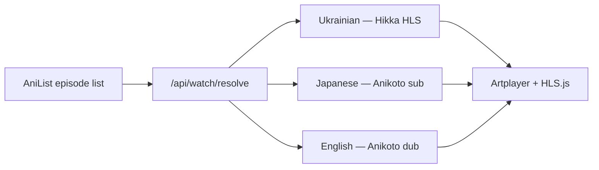
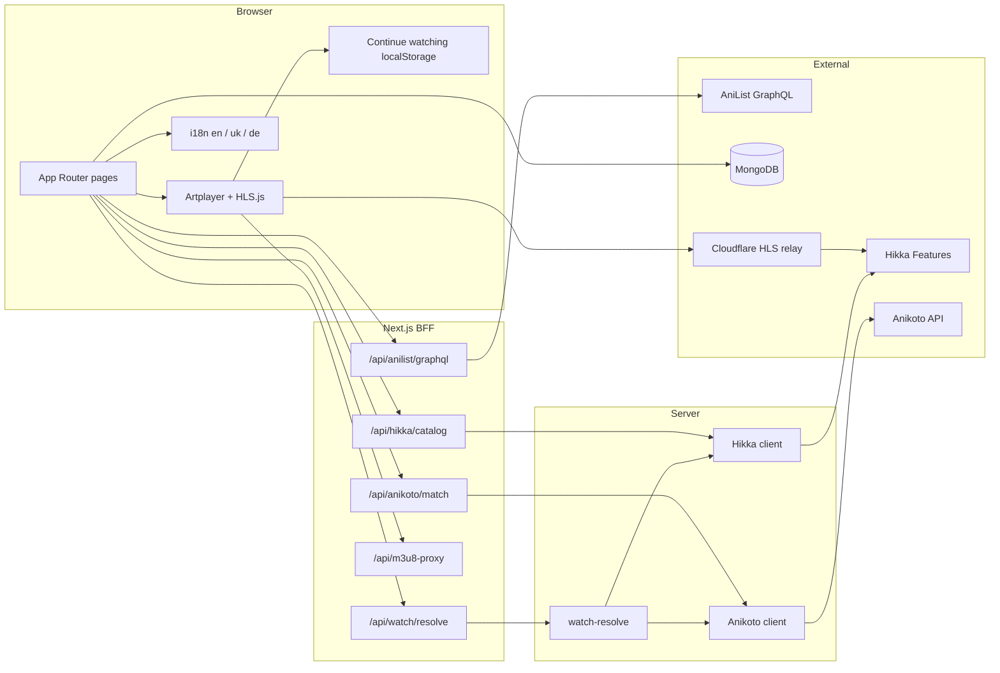

<div align="center">

# OtakuFusion

**A modern anime streaming web app** — discovery, a custom HLS player, accounts, and multi-language UI.

[](https://nextjs.org/)
[](https://react.dev/)
[](https://www.typescriptlang.org/)
[](LICENSE)
[](https://github.com/Pashahu1/OtakuFusion/actions/workflows/ci.yml)
[](https://otaku-fusion.vercel.app/)

[Live demo](https://otaku-fusion.vercel.app/) · [Features](#features) · [Playback](#playback) · [Quick start](#quick-start) · [Deploy](#deployment-vercel)

</div>


---

## Overview

OtakuFusion is a full-stack **Next.js 16** (App Router) app for browsing and watching anime.

- **Metadata** comes from **AniList**. The episode list stays on that numbering.
- **Audio** is chosen separately from the catalog: **Ukrainian** via **Hikka**, **Japanese** and **English** via **Anikoto**.
- The player is **Artplayer + HLS.js**, with skip intro/outro, an HLS quality ladder, Anime4K enhance, and continue watching.
- UI language is **English / Українська / Deutsch** (client i18n). Catalog titles, genres, and episode names stay **English** (API data).

**Live demo:** [https://otaku-fusion.vercel.app/](https://otaku-fusion.vercel.app/)

This is a **portfolio / educational project**, not a licensed commercial streaming service.

---

## Playback

The episode catalog does not change when the audio track changes. Ukrainian, Japanese, and English are playback choices on the same episode number.

| Track | Source | When it is offered |
|-------|--------|--------------------|
| **Japanese** | Anikoto (`type=sub`) | Default when the title match has Japanese audio |
| **English** | Anikoto (`type=dub`) | Only when the dub playlist is a different file from the Japanese one |
| **Ukrainian** | Hikka | Only when the player file matches the open season (part, arc, year) |

If Japanese is missing, playback falls back to Ukrainian when Hikka is eligible, otherwise to English when that dub exists. The series page lists only the languages that passed these checks. Subtitles are marked available in the player when Japanese or English audio exists; a Ukrainian-only title stays “none”.

Continue watching stores progress on the Hikka catalog. It does not restore the last Japanese or English choice — the next visit starts on Japanese again when that track exists.



---

## Table of contents

- [Features](#features)
- [Screenshots](#screenshots)
- [Playback](#playback)
- [Tech stack](#tech-stack)
- [Architecture](#architecture)
- [Known limitations](#known-limitations)
- [Prerequisites](#prerequisites)
- [Quick start](#quick-start)
- [Environment variables](#environment-variables)
- [Scripts](#scripts)
- [Project structure](#project-structure)
- [Deployment (Vercel)](#deployment-vercel)
- [Contributing](#contributing)
- [Author](#author)

---

## Screenshots

The banner above is the **home page** (spotlight + trending).

For **watch**, **HLS playback**, and **account** flows, open the [live demo](https://otaku-fusion.vercel.app/).

---

## Features

### Watch

- Custom **Artplayer** UI — HLS quality ladder, scrolling subtitle list, skip intro/outro, next episode
- **Anime4K enhance** (Off / Restore / Quality / Auto) runs on the GPU after the file is downloaded. It is separate from the HLS quality ladder
- Progress bar keeps a light track; only the played portion is orange
- **Continue watching** — progress and resume position. Audio falls back to Japanese on the next visit when that track exists
- Server-side **stream resolve** (`/api/watch/resolve`) for Hikka and Anikoto
- Optional **Cloudflare HLS relay** for CDN segments that need Referer / CORS

### Discover

- Home spotlight carousel and catalog rows
- Search with debounce
- Genre hub + discover sections (new / popular / simulcast)
- Release schedule calendar

### Account

- Register / login with email verification (SMTP)
- Profile, heatmap, activity, optional Cloudinary avatar
- Favorites synced to MongoDB
- Appearance: five dark themes + UI language (en / uk / de)

---

## Tech stack

| Area | Technologies |
|------|----------------|
| App | Next.js 16 (App Router, Turbopack), React 19, TypeScript |
| Styling | Tailwind CSS 4, SCSS design tokens (`data-theme`) |
| Video | Artplayer 5, HLS.js, `/api/m3u8-proxy`, optional Cloudflare relay |
| Data (UI) | TanStack Query |
| Data (watch) | Feature hooks + `localStorage` (continue watching, provider map) |
| i18n | i18next + react-i18next (`en`, `uk`, `de`) |
| API | Next.js Route Handlers, Zod |
| Auth | JWT (`jose` HS256) + HTTP-only cookies |
| Database | MongoDB (Mongoose) |
| Metadata | AniList GraphQL |
| Streams | Hikka (Ukrainian HLS), Anikoto (Japanese / English HLS) |
| Tests | Vitest |

---

## Architecture



**Catalog and Ukrainian audio**

1. `POST /api/hikka/catalog` resolves the Hikka title and episode list.
2. The first player file is checked against the open title (arc, part, season folder). A mismatch hides Ukrainian and keeps the AniList episode count.
3. `GET /api/watch/resolve` without `playback_audio` extracts the Ukrainian HLS URL.

**Japanese and English**

1. `GET /api/anikoto/match` scores the AniList title against Anikoto search hits (season, stage, episode count).
2. `playback_audio=ja|en` asks Anikoto for `type=sub` or `type=dub` on the same episode number.
3. English is returned only when its playlist URL differs from the Japanese one. Artplayer plays the stream through `/api/m3u8-proxy` with the provider Referer.

---

## Known limitations

| Area | What to expect |
|------|----------------|
| **Title match** | Anikoto and Hikka are matched by title, season, and episode count. A rare split cour can still land on the wrong entry when the file path has no season marker. |
| **English dub** | Hidden when Anikoto serves the same playlist for `sub` and `dub`. |
| **Ukrainian dub** | Hidden when the Hikka player file belongs to another part or season. |
| **Third-party streams** | Coverage and uptime depend on Hikka and Anikoto. |
| **Hikka on Vercel** | Upstream may block the server IP — set **`HIKKA_FEATURES_RELAY_BASE`** if Ukrainian tracks return 403. |
| **Anikoto on Vercel** | The JSON API needs no extra env. Megaplay HLS can still fail if the CDN blocks Vercel IPs through the m3u8 proxy. |
| **HLS on Vercel** | Some CDNs need **`NEXT_PUBLIC_M3U8_PROXY_BASE`** (`workers/hls-relay`). Same-origin `/api/m3u8-proxy` is fine locally. |
| **Catalog copy** | Series titles, genres, and episode names stay English (API). Only chrome/UI is translated. |
| **Account** | Register/login and favorites work; email verification is optional. |
| **Scope** | No native app, offline/PWA, or guaranteed audio track for every episode. Continue watching is browser `localStorage` and does not restore Japanese or English. Favorites are MongoDB for signed-in users. |

---

## Prerequisites

| Requirement | Required? | Notes |
|-------------|-----------|--------|
| Node.js 22 | Yes | Matches CI |
| MongoDB | Yes | Auth, favorites |
| SMTP | Yes | Verification emails |
| Hikka | Yes for Ukrainian playback | Direct or `HIKKA_FEATURES_RELAY_BASE` |
| Anikoto | No extra setup | Public API; override with `ANIKOTO_API_BASE` |
| `NEXT_PUBLIC_SITE_URL` | Recommended | Metadata |
| Cloudinary | Optional | Avatars |
| TVDB API key | Optional | Hero clear logos |
| Cloudflare HLS relay | Optional | `workers/hls-relay` |

---

## Quick start

### 1. Clone & install

```bash
git clone https://github.com/Pashahu1/OtakuFusion.git
cd OtakuFusion
npm install
```

### 2. Configure environment

```bash
cp .env.example .env.local
```

**Minimum `.env.local`:**

```env
MONGODB_URI=mongodb+srv://...
NEXT_JWT_ACCESS_SECRET=   # openssl rand -base64 32
NEXT_JWT_REFRESH_SECRET=  # different random string
SMTP_HOST=
SMTP_PORT=587
SMTP_USER=
SMTP_PASS=

NEXT_PUBLIC_SITE_URL=http://localhost:3000
WATCH_PROBE_SKIP_VARIANT=1

# Optional — if Hikka blocks your IP
# HIKKA_FEATURES_RELAY_BASE=https://your-hikka-relay.workers.dev
```

Full reference: **[`.env.example`](.env.example)**.

### 3. Run locally

```bash
npm run dev
```

Open **[http://localhost:3000](http://localhost:3000)**.

### 4. Production checks

```bash
npm run lint
npm run type-check
npm run test
npm run build
```

Or one shot:

```bash
npm run predeploy
```

### 5. Optional: HLS relay

```bash
cd workers/hls-relay
npx wrangler deploy
```

Set `NEXT_PUBLIC_M3U8_PROXY_BASE` to the worker URL, then restart / redeploy the app.

---

## Environment variables

### Required

| Variable | Purpose |
|----------|---------|
| `MONGODB_URI` | Database |
| `NEXT_JWT_ACCESS_SECRET` / `NEXT_JWT_REFRESH_SECRET` | Auth tokens |
| `SMTP_*` | Email |

### Recommended on Vercel

| Variable | Purpose |
|----------|---------|
| `NEXT_PUBLIC_SITE_URL` | Canonical production URL |
| `WATCH_PROBE_SKIP_VARIANT=1` | Faster watch resolve |
| `HIKKA_FEATURES_RELAY_BASE` | Hikka relay if origin IP is blocked |
| `NEXT_PUBLIC_M3U8_PROXY_BASE` | Cloudflare HLS relay |

### Optional

| Variable | Purpose |
|----------|---------|
| `TVDB_API_KEY` | Hero artwork |
| `CLOUDINARY_*` | Avatar upload |
| `NEXT_PUBLIC_HLS_DIRECT_HOST_SUFFIXES` | CDN hosts that skip `/api/m3u8-proxy` |
| `ANIKOTO_API_BASE` | Anikoto API origin. Default `https://anikoto-api.vercel.app` |

Never commit `.env` or secrets. Use **`.env.local`** for development.

---

## Scripts

| Command | Description |
|---------|-------------|
| `npm run dev` | Next.js dev server (Turbopack) |
| `npm run build` | Production build |
| `npm run start` | Serve production build |
| `npm run lint` | ESLint |
| `npm run type-check` | `tsc --noEmit` |
| `npm run test` | Vitest |
| `npm run predeploy` | lint → tsc → test → build |
| `npm run analyze` | Bundle analyzer |
| `npm run format` | Prettier |

---

## Project structure

```
src/
├── app/                      # App Router pages + Route Handlers
│   ├── (home)/
│   ├── watch/[id]/           # Series + /play
│   ├── api/
│   │   ├── watch/resolve/
│   │   ├── hikka/
│   │   ├── anikoto/
│   │   ├── m3u8-proxy/
│   │   ├── auth/
│   │   └── anilist/
│   ├── search/ schedule/ discover/ anime/
│   └── profile/ auth/ about/ privacy-policy/
├── features/
│   ├── watch/                # Catalog, resolve, continue watching, CTA
│   ├── player/               # Artplayer, HLS, language menu, layers
│   ├── auth/ profile/ theme/ discover/
├── server/                   # Server-only clients (Hikka, Anikoto, resolve)
├── i18n/                     # en / uk / de dictionaries
├── components/               # Shared chrome (header, cards, calendar)
├── lib/ models/ shared/
└── proxy.ts                  # Edge auth gate for /profile

workers/
├── hls-relay/                # Cloudflare HLS edge relay
└── hikka-features-relay/     # Optional Hikka IP relay
```

---

## Deployment (Vercel)

**Checklist:**

- [ ] MongoDB, JWT, SMTP env vars
- [ ] `NEXT_PUBLIC_SITE_URL` → production domain
- [ ] `WATCH_PROBE_SKIP_VARIANT=1`
- [ ] `HIKKA_FEATURES_RELAY_BASE` if UA streams 403 on Vercel
- [ ] Optional: deploy `workers/hls-relay`, set `NEXT_PUBLIC_M3U8_PROXY_BASE`
- [ ] Redeploy after any `NEXT_PUBLIC_*` change

[](https://vercel.com/new/clone?repository-url=https://github.com/Pashahu1/OtakuFusion)

**Smoke test (~5 min)**

- [ ] Home — spotlight + rows
- [ ] Search returns results
- [ ] Watch page — episode list
- [ ] Player starts on **Japanese** when Anikoto has it, otherwise Ukrainian or English
- [ ] Language menu and the series page list only tracks that exist
- [ ] A title whose Hikka file is another season does not offer Ukrainian
- [ ] Register / login persists after refresh
- [ ] Settings — theme + UI language chips (en / uk / de)

---

## Contributing

1. Open an issue for bugs or ideas.
2. Fork → branch (`feat/...` or `fix/...`).
3. Run `npm run predeploy` before a PR.
4. Never paste API keys in issues or PRs.

---

## Author

**Pavlo Chudyn** — Software Engineer

[](https://github.com/Pashahu1)
[](https://www.linkedin.com/in/pavlo-chudyn-978547246)
[](https://t.me/PashaChudin)

---

<div align="center">

If OtakuFusion is useful to you, consider giving the repo a **star**.

</div>
